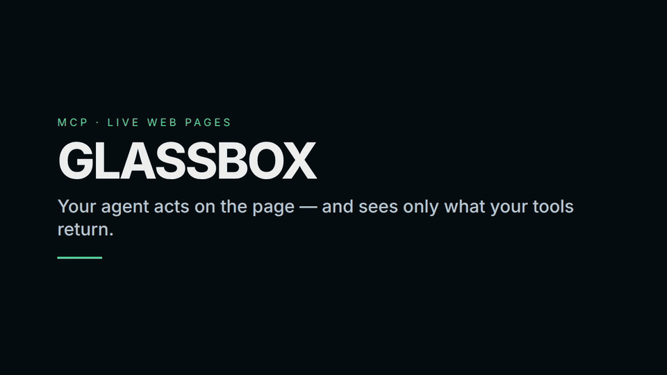
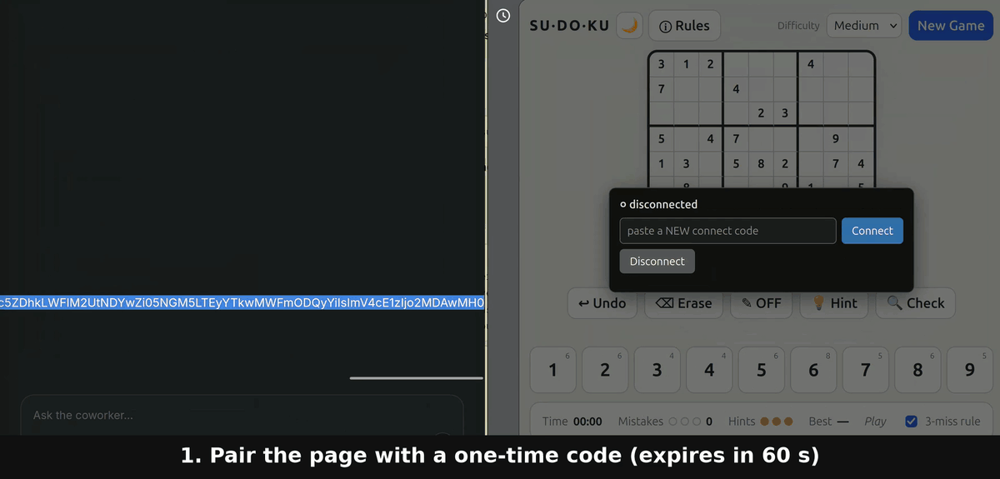
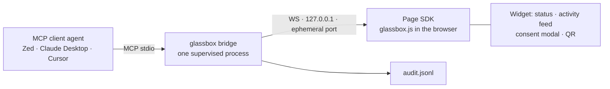

# mcp-glassbox

[](https://github.com/sa-eed-afzal/glassbox/actions/workflows/ci.yml)


[](LICENSE)

**Your AI coding agent, with hands on a live web page — and a trust layer you
can defend.**

mcp-glassbox is an MCP server that lets an MCP client (Zed, Claude Desktop,
Cursor) discover and call **tools that live on a web page**: page state, game
moves, form actions, sampling prompts — anything your page registers. The
agent acts on the page through a transparent local bridge; every call is
consent-gated where you want it and lands in an audit trail you can inspect.



<sub>Real tool calls, no mock-ups: pairing → live tool discovery → `get_state` →
consent modal → the agent plays 46 moves → audit trail.
[Full 2-minute video (MP4)](https://github.com/sa-eed-afzal/glassbox/raw/main/docs/images/glassbox-demo.mp4)</sub>

#### Using Glassbox from an AI agent (OpenWorker)



<sub>A general-purpose agent, not a coding agent: [OpenWorker](https://github.com/andrewyng/openworker)
pairs with the page, reads the board through `get_state`, solves it with a script,
and places 12 digits. Each placement was approved by a human on the page.
Setup guide: [`docs/openworker.md`](docs/openworker.md).</sub>

> **Live example:** [`sudoku/`](sudoku/) — a dependency-free Sudoku game with
> nine Glassbox tools (two read, seven consent-gated write). The agent reads the
> board as nine strings from `get_state`; it never sees a screenshot.

## Try it with your agent

Paste the prompt below into your coding agent (Claude Code, Zed, Cursor, …).
It clones the repo, runs the one-command setup, gives you the config snippet to
paste into your MCP client, and then plays a round of Sudoku through **real**
tool calls.

<details>
<summary><b>Copy this prompt</b></summary>

```text
Set up mcp-glassbox on my machine and demonstrate it with the Sudoku example.
Show me each command before running it. Do NOT edit my MCP client config files
and do NOT take screenshots — I will paste the config myself.

PHASE 1 — setup
1. Clone https://github.com/sa-eed-afzal/glassbox.git into ~/Projects/glassbox
   (or pull if it already exists), then cd into it.
2. Run `npm run setup`. It installs exact pinned dependencies, builds dist/,
   runs the 15-check preflight, and prints ready-to-paste MCP config snippets
   for Zed / Claude Desktop / Cursor with absolute paths filled in. Stop if
   any step fails and show me the error.
3. Show me the snippet for MY client and explain where to paste it.
4. Start the showcase page in a separate shell:
   `python3 -m http.server 3002 --bind 127.0.0.1 --directory sudoku`
   and tell me to open http://127.0.0.1:3002.
5. Stop here. Ask me to paste the snippet into my client, restart the client,
   and reply "ready".

PHASE 2 — after I say "ready" (you should now have glassbox MCP tools)
6. Call the `glassbox_code` tool with app="sudoku-game" and
   origin="http://127.0.0.1:3002". Give me the code immediately — it expires
   in 60 seconds — and ask me to paste it into the widget on the page.
7. When I say connected, call the page tool whose name ends in `__get_state`.
   Explain that the nine returned strings are the agent's ENTIRE view of the
   board: no screenshot, no DOM dump, no pixels.
8. Call the tool ending in `__new_game` with {"difficulty":"easy"} so I can see
   the consent modal. Ask me to approve it on the page before continuing.
9. Call the tool ending in `__check`, then show me the last lines of
   ~/.local/state/glassbox/audit.jsonl and explain the tier, consent outcome
   and argument hash.

Use 127.0.0.1 (not localhost) in the origin — origin binding is exact.
```

</details>

## Why use it

- **Agents can act on live pages, not just files.** Your page's tools appear
  in the client's tool list the moment they register (`tools/list_changed` —
  no client restart), and the client's agent calls them like any other MCP
  tool.
- **Writes are gated, reads are free.** Tools carry a tier (`read` / `write` /
  `dangerous`); per-app policy decides `auto` / `consent` / `deny`. A
  consent-gated call pauses until a human approves it **on the page** — a
  topmost modal nothing in the app's own overlay stack can cover.
- **Every call is auditable.** JSONL audit log (0600 file, 0700 dir) with
  trace IDs, client, tier, consent outcome and argument hashes; the widget's
  activity feed mirrors it live.
- **Safe by construction.** Loopback-only host, ephemeral port, one-shot
  connect codes with a 60 s TTL, origin-bound at both hops, per-client
  credentials, per-call deadlines, idle expiry. No daemons, no PID files, no
  world-readable secrets.
- **One page-side line.** `new Glassbox("myapp")`, `gbox.tool(...)`,
  `renderWidget(gbox)` — the SDK owns the protocol; the page never learns
  MCP framing.
- **Connect by paste or phone camera.** Codes render as QR (in-bundle
  ISO/IEC 18004 encoder, zero runtime deps) and verify without a scanner
  (`glassbox decode`, the widget's simulated scan).
- **The conformance suite is the spec.** `glassbox test` drives the whole
  protocol against a running bridge + your page — in CI or on a laptop.
- **Boring tech, small surface.** Node ≥ 20, ESM, TypeScript strict, ≤ 3
  runtime deps, 210 tests, dependency-drift self-check.

## Why not Playwright?

Different jobs: Playwright *drives a browser* (click selectors, assert the DOM,
capture screenshots). Glassbox doesn't control a browser at all — the page
registers typed tools and the agent calls them. But for the specific problem of
**testing a flow that needs credentials**, the difference is the point:

- **The observation channel is not a screenshot.** In a typical browser-agent
  loop the agent sees the viewport, so everything rendered there — unrelated
  tabs, another user's data, a private dashboard — is shipped to the model,
  whether or not you meant to include it. Glassbox sends only the values your
  tools return. The page is never serialized or described.
- **Credentials can stay inside the page.** A tool like
  `login({ username, password })` puts those values in the model's context.
  Keep the session/credential in page context and expose a zero-argument
  `login()` tool instead: the agent can act without ever handling the secret.
  (The [`sudoku/`](sudoku/) showcase needs no credentials at all, so nothing is
  exposed by construction.)
- **Mutations are gated and auditable.** `write`/`dangerous` tools pause for a
  consent modal nothing in the app's overlay stack can cover, and every call
  writes a JSONL line with tier, consent outcome and an argument hash.

Glassbox is **not** a Playwright replacement: it cannot test sites you don't
own, take visual snapshots, or drive cross-browser suites. It is for pages you
control, where the tool signature is a stable API and privacy of the
observation channel is part of the requirement.

## How it works



The bridge is **spawned by the MCP client** (one config snippet) and dies
with it. A one-shot, origin-bound connect code exchanges for a session; the
page's tools then appear in the client, and every call round-trips through
the bridge's tier/consent policy and audit. A page reload re-attaches
automatically — no re-pasting.

## Quickstart

**[`docs/quickstart.md`](docs/quickstart.md)** wires a page to Zed / Claude
Desktop / Cursor in under 5 minutes (a timed clean-checkout run took 31 s):

```sh
git clone https://github.com/sa-eed-afzal/glassbox.git && cd glassbox
npm run setup   # exact deps, build, 15-check preflight, then prints your client's
                # config snippet with absolute paths filled in
```

The page side is:

```html
<script type="module">
	const { Glassbox, renderWidget } = await import("/glassbox.js");
	const gbox = new Glassbox("myapp");
	gbox.tool("status", "Current state", () => ({ score: 420 }));
	gbox.tool("play_move", "Do a thing", { tier: "write", x: { type: "number" } },
		({ x }) => ({ played: x }));
	renderWidget(gbox);
</script>
```

## Status

The `glassbox/v1` protocol is frozen and fully implemented: bridge, page SDK +
widget, consent and policy, audit, reconnect, QR pairing, and the public
conformance suite (`glassbox test`). CI runs build, typecheck, lint, the
210-test suite, the dependency self-check, and the conformance preflight on
Node 20 and 22. Not yet published to npm; open design questions live in
[spec §12](docs/spec.md#12-open-decisions).

## Repository layout

```
src/core/     protocol core — ZERO runtime deps (auditable, browser-safe)
src/bridge/   session registry, code store, dispatch, audit (node, core-only deps)
src/host/     WS host on 127.0.0.1 + ephemeral port (ws + node:http)
src/mcp/      MCP stdio server (tools/prompts/resources/sampling, list_changed)
src/cli.ts    glassbox bridge | code | channels | drop | status | test | decode
sdk/          glassbox.ts — page SDK + widget (bundled to dist/glassbox.js, zero deps)
fixtures/     echo-app conformance fixture (page side of glassbox/v1)
sudoku/       showcase app — 9 tools, consent-gated, no credentials involved
docs/images/  curated screenshots used in this README and the example docs
test/         unit + property (fast-check) + conformance + host/SDK suites (210 tests)
scripts/      setup, selfcheck (dependency drift guard), serve-fixture
docs/spec.md  the normative spec
```

## Development

```sh
npm run setup          # one command: npm ci + build + preflight, prints client snippets
npm ci                 # exact pins from the lockfile
npm test               # unit + property + conformance + host + SDK (210 tests)
npm run build          # dist/ — node CLI/library + browser glassbox.js
npm run selfcheck      # resolved tree must match package.json pins
npm run check          # biome lint/format
node dist/cli.js test  # full-protocol preflight (embedded bridge + fixture)
```

## Principles (spec §3)

1. One process, no daemons — client dies, bridge dies.
2. The page never learns MCP — the bridge owns all framing and coercion.
3. Explicit trust boundaries — loopback only, per-client credentials.
4. Spec first — the conformance suite *is* the spec, runnable in CI.
5. Boring tech — Node ≥ 20, ESM, pinned deps, ≤ 3 runtime packages.

## Documentation

- [`docs/quickstart.md`](docs/quickstart.md) — wire a page in < 5 minutes
- [`docs/spec.md`](docs/spec.md) — the normative spec: protocol, security
  model, policy schema, milestones
- [Demo video (MP4)](https://github.com/sa-eed-afzal/glassbox/raw/main/docs/images/glassbox-demo.mp4) —
  2-minute walkthrough with real tool calls, consent and the Sudoku play-through
- [`docs/openworker.md`](docs/openworker.md) — verified integration with
  [OpenWorker](https://github.com/andrewyng/openworker), with a copy-paste
  onboarding prompt and the dynamic-tool caveat

## License

MIT — see [`LICENSE`](LICENSE).
