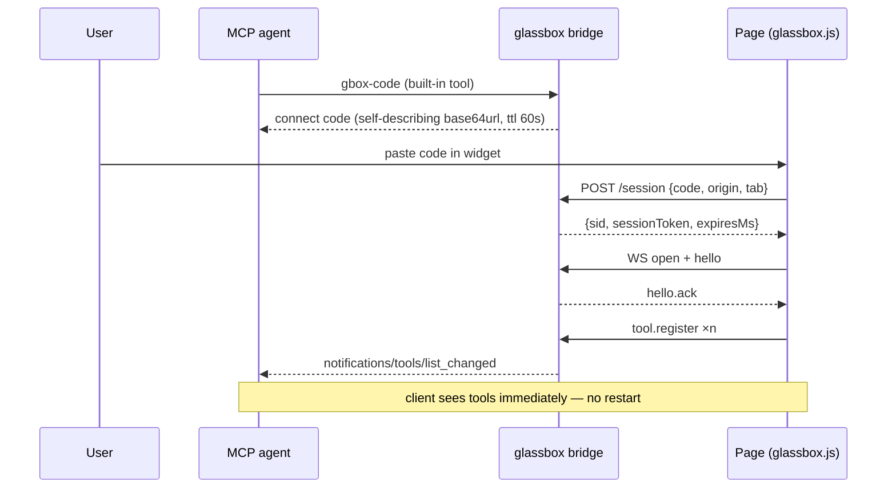
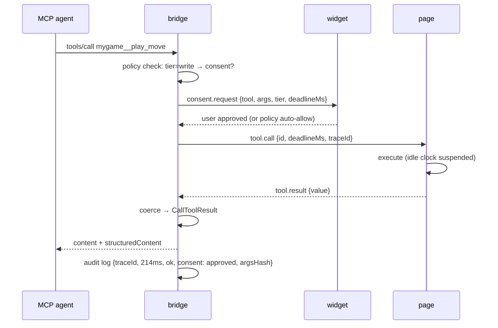

# Glassbox — a transparent, trustworthy WebMCP-style bridge

**Status:** implemented — milestones M0–M4 complete (§11). Open items: the
optional Chrome native WebMCP adapter and §12 open decisions 1–3.
**Author:** Saeed · **Date:** 2026-09-27
**Mandate:** replace a third-party page↔MCP bridge with one we fully own,
understand, can test, and can defend — driven by defects observed first-hand
while wiring a browser game (a SameGame speedrun) to an AI agent through it.

---

## 1. Why a replacement

We spent a real integration session fighting the prior bridge's stack. Every
defect below was **reproduced first-hand** (see §10 Evidence Log). The
pattern: the system works as a demo but is built for convenience, not for an
agent driving a live page as a safety- and correctness-critical path.

### 1.1 Defect summary (prior bridge → Glassbox requirement)

| # | Defect observed | Requirement in Glassbox |
|---|---|---|
| D1 | `npm i` hoisted **zod 4.6.5**, crashing the MCP SDK client mid-call (`v3Schema.safeParse is not a function`) — no lockfile, loose `^` ranges | Pinned deps, committed lockfile, runtime version-assert on startup; the bridge must never depend on hoisting |
| D2 | Bridge **returned the page's result verbatim** as the MCP `CallToolResult`; a plain JS object broke client validation — the page had to learn the MCP result shape | Bridge **coerces** any page result (string / object / array) into a valid `CallToolResult` (`content` + `structuredContent`); the page SDK never sees MCP framing |
| D3 | Tool naming inconsistent: `localhost_8123-status` (dash) vs an underscore-prefixed token tool (underscores) | One canonical scheme, single separator, ≤64 chars, documented (§5.3) |
| D4 | Registration token is **single-use**, base64-decodable (`{"server":"ws://localhost:4797","token":"f37c…"}` — leaks internal address), stored in `sessionStorage` (per-tab; new tab = re-paste), **5-min inactivity disconnect** mid-task | Code→session exchange with TTL, refresh + auto-reconnect, in-flight tool calls exempt from idle expiry (§5.2) |
| D5 | Global daemon: "Server is already running with PID 1252427"; `--quit` kills **all** channels; state in a global hidden directory | Single supervised process, lifecycle tied to the MCP client, per-channel state (§4.1) |
| D6 | The server token sat in a **world-readable `.env` file** in that global directory — any local process can impersonate the MCP client | OS keychain / 0600 credential file with per-client nonces; loopback bind only (§7) |
| D7 | New tools require **restarting the MCP client** (no `notifications/tools/list_changed`) | Bridge emits `tools/list_changed` on every register/unregister (§5.4) |
| D8 | No page-side deadline: a hung page **hangs the client forever** (we built a 120 s wait into `finish_run` to cope) | Bridge enforces per-call deadlines; timeout → structured `isError` (§5.5) |
| D9 | No consent model: the agent can call **any** registered tool (arbitrary page JS) with zero human gate | Tool permission tiers + optional user confirmation, per channel policy (§7.3) |
| D10 | `package.json` declares Node **core modules as npm deps** (`http`, `path`, `os`, `url`, `child_process`, `crypto`) — fake-package / supply-chain smell | Zero fake deps; dependency allowlist enforced in CI (§8) |
| D11 | No protocol version, no tests, 2 000-line single-file widget, bundled opaque bridge | Versioned hello, spec + conformance suite in CI, small auditable modules (§9) |
| D12 | No observability: only `console.log` | Structured JSONL audit log, per-call trace IDs, in-widget activity feed (§5.6) |
| D13 | Text-only results; JSON stringified in a `text` part | `structuredContent` (MCP 2025-06) with JSON `text` fallback for older clients (§5.4) |
| D14 | Namespace collision with Chrome's official **WebMCP** (`window.mcpTool`) — same name, different thing | Distinct name (Glassbox) + optional future adapter for the native Chrome API (§11) |

---

## 2. Goals / non-goals

**Goals**
1. Let an MCP client (Zed, Claude Desktop, Cursor, any stdio client) call **tools, prompts,
   resources, and sampling** implemented in a running web page, over localhost.
2. **Glassbox principle:** every line of protocol, trust, and state is inspectable by one
   engineer in one sitting. Total source (bridge + page SDK + tests) < 3 000 LOC.
3. Correct by construction: protocol conformance suite ships with the repo and runs in CI.
4. Safe by default: nothing leaves the machine; mutating page actions are tiered and
   confirmable; every call is audited.

**Non-goals**
- Remote/Internet deployment (loopback-only; a future Tailscale/HTTPS mode is a separate spec).
- Replacing a general-purpose MCP server — Glassbox is a **bridge** between MCP and a DOM.
- Baking in any LLM/agent logic.

---

## 3. Design principles

1. **One process, no daemons.** The MCP client config launches `glassbox bridge`. The bridge
   supervises its own host (WebSocket server) as a child in the same process group. Client
   dies → host dies. No PID files, no global state directory, no "already
   running with PID …".
2. **The page never learns MCP.** The page SDK (`glassbox.js`, plain ESM, no framework)
   returns plain values. The bridge owns all MCP framing, coercion, timeouts, and names.
3. **Explicit trust boundaries.** Page ⇄ bridge = tokenized session bound to
   `origin + channel`. Client ⇄ bridge = per-client credential (keychain), never a shared
   world-readable file. Everything else (other local processes, other browsers) is
   untrusted by default.
4. **Spec first, code second.** The protocol (Part 2) is normative; code that diverges is a
   bug. Conformance tests encode the spec.
5. **Boring tech.** Node ≥ 20, `ws` (or built-in), no build step for the bridge, no code
   generation, no runtime eval of user config.

---

## 4. Architecture

```
┌───────────────────────────── your machine (loopback only) ─────────────────────────────┐
│                                                                                        │
│  MCP client (Zed / Claude / …)                                                         │
│   │  stdio: JSON-RPC (MCP)                                                             │
│   ▼                                                                                    │
│  ┌──────────────────────── glassbox bridge (1 process) ────────────────────┐           │
│  │  mcp/        stdio MCP server: tools, prompts, resources, sampling      │           │
│  │  host/       WebSocket host on 127.0.0.1:ephemeral (no fixed port)      │           │
│  │  core/       sessions, channels, codecs, policy, audit, clock, timeouts │           │
│  │  sdk/        glassbox.js — page-side SDK + widget (vanilla ESM)         │           │
│  └─────────────────────────────────────────────────────────────────────────┘           │
│   ▲  WSS-over-loopback (ws://127.0.0.1:PORT/session/{sid})                            │
│   │                                                                                    │
│  Browser tab — your app + <script src="glassbox.js">                                   │
│   • new Glassbox('mygame')                                                             │
│   • .tool('status', 'desc', fn)   .tool('play_move', {tier:'write'}, fn)               │
│   • widget: connect code, activity feed, consent prompts, permission panel             │
└────────────────────────────────────────────────────────────────────────────────────────┘
```

### 4.1 Process & lifecycle (fixes D5)

- `glassbox bridge` = the **only** long-lived process; it forks the host with `child_process`
  in the same group and reaps it on SIGTERM/exit of the client-spawned bridge.
- Port: ephemeral, allocated at start, printed to stderr (`glassbox host on 127.0.0.1:54321`)
  and embedded in the connect code (never guessed, never fixed).
- No global state directory. Session registry is in-memory; credential material in OS
  keychain (fallback: `~/.config/glassbox/creds.json` mode 0600, checked at startup).
- `glassbox channels` CLI lists live channels + last 10 calls (audit readout).

### 4.2 Page SDK surface (fixes D2, D11)

```js
const gbox = new Glassbox('mygame');                 // app id → channel
gbox.tool('status', 'Current game state', async () => ({ score: 420 }));
gbox.tool('play_move', 'Clear the group at x,y',
          { tier: 'write', timeoutMs: 5000 },
          async ({ x, y }) => ({ played: true }));
gbox.resource('board://state', 'Live board', async () => boardJSON);
gbox.prompt('explain', { description: '…', args: [{ name: 'why' }] }, async (a) => [/*messages*/]);
gbox.on('call', ({ name, args, phase, ms }) => feed.push(...));   // widget activity feed
```

- **Tiers:** `write` (default; mutates page state, asks consent) · `read` (no side effects) · `dangerous` (spends money,
  deletes, talks to 3rd parties). Tier is advisory metadata the bridge enforces via policy.
- **Options vs. schema:** the third argument is either an options object
  (`tier`, `timeoutMs`, `inputSchema`) or a bare property map used as the input schema.
  Options and schema properties must not be mixed: a mix throws at registration, so `tier`
  can never be dropped silently. An unknown `tier` or a non-positive `timeoutMs` also throws
  at registration. A bare property map whose `tier` value is a schema (not a string) is a
  valid schema property.
- Return values: any JSON-able value → bridge coerces (§5.4). Throws → `isError: true` with
  `code`, `message`, `traceId`.

---

## 5. Protocol (normative, `glassbox/v1`)

All messages are JSON text frames over the session WebSocket. The MCP side is standard MCP
(JSON-RPC 2.0 over stdio); this section defines the **bridge ⇄ page** wire protocol.

### 5.1 Handshake & versioning (fixes D11)

Page → host, on socket open:

```json
{ "v": "glassbox/v1", "sid": "<session>", "app": "mygame",
  "origin": "http://localhost:8123", "tab": "<tab-nonce>" }
```

Host responds `hello { v, server: "glassbox/x.y.z", expiresMs }` or
`error { code: "VERSION_MISMATCH" }` (hard fail — no silent compat drift).

**Origin binding (M4, 2026-09-30):** the `origin` in `hello` must match the origin the
session was issued for; anything else is `error { code: "PROTOCOL_ERROR",
message: "origin mismatch…" }` + immediate socket close. The exchange check (§5.2) and
this handshake check close the same loop: a code minted for one page is useless on any
other, at every hop where it could be presented.

Client ⇄ bridge uses standard MCP `protocolVersion` negotiation.

### 5.2 Session & connect-code model (fixes D4, D6)

```
1  CLI/agent:   gbox-code  →  { code: "eyJ2IjoiZ2J4L3YxIiwiaG9zdCI6…"  (base64url, ~200 chars),
                               ttl: 60s, channel: "mygame@localhost:8123" }
2  User pastes code in the widget.
3  Page SDK → POST /session { code, origin }   (tab is presented with `hello`, §5.1)
4  Bridge →    { sid, sessionToken, refreshToken, expiresMs }
5  Page SDK stores sid in sessionStorage (survives reload), refreshToken in memory.
6  Auto-reconnect: backoff 250 ms → 4 s, re-auth via sessionToken, then refresh.
```

- Connect codes: one-shot, **60 s TTL**, bound to `origin + app`; rejected with typed error.
  **Binding enforcement (M4, 2026-09-30):** the origin binding is checked at both hops
  where a code identity claim is possible — the session exchange (`POST /session`
  presents the page origin; mismatch → typed `PROTOCOL_ERROR` "connect code is bound to
  origin …", HTTP 400) and the WS handshake (`hello` presents the origin; mismatch →
  typed `PROTOCOL_ERROR` "origin mismatch …" + socket close, §5.1). Comparisons use the
  normalized host key (scheme, path, query stripped; lowercased). One-shot means one
  attempt: a rejected exchange still consumes the code, so a retry requires re-minting.
  An exchange **without** an origin is rejected (HTTP 400) before the code is consumed,
  so omitting the field cannot skip the check (2026-11-24).
- **The origin is a claim, not proof.** A browser cannot fake it, but a non-browser
  client can present any origin, and the agent can mint codes itself (`glassbox_code`).
  So a code is enough to *pair*, but not enough to *act* on a page that is already
  connected: see §5.2a.
- **Code format (M3 decision, 2026-09-29):** a connect code is the single base64url
  string of `{ v, host, port, channel, app, codeId, expMs }` — self-describing: the
  endpoint is embedded in the code because the code is the *only discovery path*
  (§7.1), and it carries no secret. A short `GBX-XXXX` display form is deliberately
  **not** a wire format: without the embedded endpoint there would be no discovery
  path left. CLI/widget may render a truncated prefix for display only.

  **QR rendering (M4, 2026-10-01; §12 #5 closed):** the full code is rendered as a QR
  verbatim by an in-bundle ISO/IEC 18004 encoder (byte mode, automatic version, all four
  EC levels, full mask evaluation — no runtime deps; the ~240-char blob encodes to a
  version-11 symbol at level L). The widget renders a live SVG as the code is typed and
  self-checks every render with a *simulated scan* (structural round-trip: format-info
  BCH, Reed–Solomon block integrity, byte-mode payload recovery); `glassbox code`
  prints an ASCII QR on stderr (stdout stays the bare code; `--no-qr` disables). The
  scanner-less verification path is `glassbox decode <code> [--port N]`: blob structure
  field-by-field + `/health` on the code's own endpoint.
- Session tokens: 30 min idle TTL, **suspended while a tool call is in flight**
  (fixes D4's mid-task disconnect); refreshable once per expiry window.
- **Reconnect states (M3 decision, 2026-09-29):** on WS channel loss with a
  recoverable session the page SDK reports `reconnecting` (attempt counter and
  next retry exposed via `reconnectProgress`) until the backoff reaches its
  4 s cap, at which point the bridge is presumed down → `offline` (retries
  continue). A rejected refresh (revoked / idle-expired) is terminal:
  `expired` — a dead end that needs a fresh connect code, which the widget
  surfaces as the "paste a NEW connect code" input. The widget's **Reconnect**
  button (`reconnectNow()`) acts only on the transient states
  (`reconnecting` / `offline`); it is hidden in dead-end states.
- **Bridge restart:** the session registry is in-memory (§4.1) and the
  port is ephemeral, so a restarted bridge can never accept the stored sid+sessionToken.
  Retries therefore never reach `expired` on their own: they keep hitting the old port.
  `offline` is the state a restart lands in. Its status line says the bridge is
  unreachable and may have restarted, and the input placeholder asks for a NEW connect
  code. Retries continue, so a transient outage with the same bridge still recovers
  without a paste. Page reloads are unaffected while the bridge is alive (§5.2 resume).
- **Session event wording:** every `connected` status event carries a `resumed` flag
  (`false` for a fresh code exchange, `true` when an existing session is re-attached —
  reload-resume or reconnect), so UIs never call a first connect a resume — in
  particular a new code pasted after the restart above is NOT one (the widget's
  feed logs "● connected" for a fresh pairing and the resume line only for a resume).
- Nothing secret is ever embedded in a base64 blob a human can read (fixes D5-E evidence:
  the old token literally contained the internal address + token).
- Revocation: `gbox-drop <sid>` (CLI) or "Disconnect" in widget → immediate RST.

### 5.2a Admission: a new connection needs a human OK (2026-11-24)

Found by testing a real agent run: a stuck agent minted a code and wrote its own
WebSocket client to reach the page directly. Without admission, such a client could
become the newest tab (and so receive the page's calls), approve its own consent, or
re-register a tool at a lower tier.

- The **first** live session on a channel is admitted on attach.
- A **later** session (a second tab, or a self-paired client) starts *not admitted*.
  The bridge sends a `consent.request` with `tool: "new connection"`, `tier: "dangerous"`
  and `args: { tab, app, origin }` to the admitted session that currently receives calls,
  so the human sees an Approve/Deny modal on the page they already trust. Existing widgets
  render it with no SDK change.
- Until approved, the newcomer receives no calls, prompts, resources or sampling requests,
  its consent answers are ignored, and its `tool.register` frames are **held** (applied on
  admission), so it cannot change a tool's tier. Deny, timeout (`consentTimeoutMs`) or the
  asking tab disconnecting → the newcomer is revoked (`session.revoke`, reason `join …`).
- Reload/reconnect re-attaches the **same** session and keeps its admission (§5.2 resume).
- Residual: if no admitted session is live (e.g. the only tab is closed or offline), the
  next session is admitted as the first one. The widget's status shows this, and every
  admission is audited (`status: "session"`).

### 5.3 Tool naming (fixes D3)

Canonical form: `<channel>__<tool>`

- `channel` = sanitized `origin.host` (`localhost:8123` → `localhost-8123`), further
  sanitized to `[a-z0-9-]`, truncated to 32 chars with `__<hash6>` on collision.
- `tool` = app tool name, sanitized to `[a-z0-9_-]`, truncated at 28 chars.
- Total ≤ 64 (MCP limit). One separator `__`, always.
- Reverse mapping exposed as MCP resource `glassbox://channels` (JSON table of
  bridge-name → channel → app tool). No guessing.

### 5.4 Result coercion (fixes D2, D13) — bridge-side, mandatory

| Page returned | Bridge produces |
|---|---|
| `string` | `{ content: [{ type: "text", text }] }` |
| JSON object | `{ content: [{ type: "text", text: JSON.stringify(v) }], structuredContent: v }` |
| JSON array | `{ content: [{ type: "text", text: JSON.stringify(v) }], structuredContent: { value: v } }` |
| `undefined`/`null` | `{ content: [{ type: "text", text: "null" }] }` |
| throw / deadline | `{ content: [{ type: "text", text: msg }], isError: true, structuredContent: { code, message, traceId } }` |

The page **cannot** produce an invalid `CallToolResult`. Structured content is sent only when
the client's negotiated `protocolVersion` ≥ 2025-06-18. The MCP schema requires
`structuredContent` to be a JSON object, so array payloads are wrapped under `value` —
the `text` part always carries the exact JSON.

### 5.5 Timeouts & in-flight semantics (fixes D8)

- Every tool schema may declare `timeoutMs` (default 10 000, max 600 000).
- Bridge starts a deadline timer on dispatch; on expiry it:
  1. marks the page call `abandoned` (page may continue, result discarded),
  2. returns `isError: true, code: "DEADLINE"`,
  3. logs `{ traceId, deadline, ms }` to the audit stream.
- While a call is in flight the session's idle clock is paused and the WebSocket is
  keepalive-pinged (25 s).

### 5.6 Tool change notifications (fixes D7)

On `tool.register` / `tool.unregister` the bridge emits MCP
`notifications/tools/list_changed` (same for prompts/resources). **No client restarts, ever.**

### 5.7 Sampling parity

Bridge → page `sampling/createMessage` carries `messages`, `systemPrompt`, `maxTokens`, and
an optional **answer schema** (JSON Schema). Widget renders a form (or textarea fallback);
the answer is validated against the schema before returning; invalid → one repair prompt,
then `isError`.

### 5.8 Message catalogue (bridge ⇄ page)

| dir | type | fields |
|---|---|---|
| P→B | `hello` | `v, sid, app, origin, tab` |
| B→P | `hello.ack` / `error` | `v, expiresMs` / `code, message, traceId?` (trace set when the error is tied to a traced frame, e.g. `tool.call` — M3) |
| P→B | `tool.register` | `name, description, inputSchema, tier?, timeoutMs?` |
| P→B | `tool.unregister` | `name` |
| B→P | `tool.call` | `id, name, args, deadlineMs, traceId` |
| P→B | `tool.result` | `id, value? , error?{code,message}` |
| B→P | `prompt.request` | `id, name, args` · `prompt.result` |
| B→P | `resource.request` | `id, uri` · `resource.result` |
| B→P | `sampling.request` | `id, messages, systemPrompt?, maxTokens, schema?` · `sampling.result` |
| P→B | `call.event` | `id, phase: start\|progress\|end, ms?` (drives widget feed + idle suspension) |
| B→P | `consent.request` | `id, tool, description, args, tier, deadlineMs` (gate for `consent`-tier calls, §7.3) |
| P→B | `consent.result` | `id, decision: approved\|denied` |
| P↔B | `session.revoke` | `reason` (B→P: bridge/CLI revokes; P→B: widget Disconnect, revokes server-side) |

---

## 6. Message flows

### 6.1 First connect (code → session)



### 6.2 A tiered tool call



Policy decision per (appId, tier) (§7.3) gates the dispatch:
- **auto** → dispatch immediately; audit `consent: "auto"`.
- **consent** → `consent.request` to the widget; the decision is awaited with its own
deadline (default 120 s, clamped to the tool deadline). Approve → dispatch. Any other
outcome → `isError: true, code: "CONSENT_DENIED"`, audit `consent: "denied"`, with a message and
audit `detail` naming the cause: `denied` ("consent denied by user"), `timeout` ("consent timed
out"), or `disconnected` (widget dropped before answering). No page traffic either way.
The widget dialog focuses Deny: Enter or Escape denies, and Approve needs a click or Tab to it
followed by Enter. Enter alone never approves. While the dialog is open, Tab and Shift+Tab cycle
between Approve and Deny and never leave the dialog.
- **deny** → `CONSENT_DENIED` without any page traffic; audit `consent: "denied"`.
Pages without a visible widget still receive the decision: `gbox.resolveConsent(id, decision)`
is the programmatic half (tests / headless).

---

## 7. Security model

### 7.1 Network
- Host binds **127.0.0.1 only** (IPv6 `::1` accepted). No `--host` flag in v1.
- Ephemeral port; connect code is the only way to discover it (it embeds `port`, scoped,
  60 s). No fixed well-known port → no cross-install collisions, no ambient listening.
- The session exchange (`POST /session`) is a cross-origin fetch from the page origin, so the
  host answers CORS preflights with `Access-Control-Allow-Origin: *` — safe because the socket
  is loopback-bound, and the code (not the endpoint) is still the only discovery path.

### 7.2 Credentials (fixes D6)
- Client credential: per-bridge **Ed25519 keypair** in OS keychain
  (macOS Keychain / libsecret via `secret-tool` / DPAPI; fallback: 0600 file at
  `~/.config/glassbox/creds.json` + a one-line startup warning). Never world-readable,
  never in the repo. `loadOrCreate` is convergent: bridge and CLI, same user, same store
  → same key, so a CLI request signed with the private key verifies against the
  bridge's allowlisted public key.
- **Nonce challenge** on the management HTTP endpoints (`POST /code`, `POST /drop`,
  `GET /channels`): the caller presents
  `X-Glassbox-Nonce` + `X-Glassbox-Signature` = Ed25519 over
  `nonce || "\n" || method || "\n" || path || "\n" || rawBody` (GET: empty body). The
  bridge verifies against the allowlist (the launching client auto-registers at spawn —
  its public key is the authorized principal; the allowlist supports N keys) and
  rejects replayed nonces (single-use, 60 s TTL window).
- Failure → **401** with a typed error (`UNAUTHORIZED`: missing nonce/signature, bad
  signature, replayed nonce) and an audit line `status: "impersonation"`. A local
  process that cannot read the 0600 credential cannot sign (§9.4 scenario).
- Page ⇄ bridge traffic is **not** nonce-checked: `POST /session` takes a one-shot
  connect code (or the stored sid+sessionToken) and the WS handshake takes the session
  token — the code carries no credential, and `/health` stays open (version-only).
- No world-readable shared-secret `.env` file, ever.

### 7.3 Permission tiers & consent (fixes D9)
- Policy file `glassbox.json` (per project or global), e.g.:

```json
{ "policy": { "mygame": { "read": "auto", "write": "consent", "dangerous": "deny" } } }
```

- `consent` → widget shows a modal: tool name, description, **args**, tier, deadline;
  user approves/denies; the decision is audit-logged.
- **Consent is bound to the asking session (2026-11-24).** A `consent.result` settles a
  request only if it arrives on the session the request was sent to. An answer from any
  other connection is ignored and audited as `impersonation` with its `session`. Request
  ids are sequential, so without this binding any connected client could approve for
  another tab by guessing ids.
- Default when no policy: `read` auto, `write` consent, `dangerous` deny.
- The page **cannot declare** a tool `read` that it knows mutates state — tier is
  declared by the app, enforced by the bridge; the audit log preserves the declared tier
  (dishonest tiers are detectable post-hoc, and the consent modal always shows args).

### 7.4 Supply chain (fixes D1, D10)
- ≤ 3 runtime deps (`ws` max); dependency allowlist + `npm ci` from a committed lockfile
  in CI; `npm audit` gate; **zero** core-module fake packages (CI check: `dependencies`
  keys must be a subset of the allowlist).
- Startup self-check, run **before** the bridge serves anything:
  1. resolved dependency majors match the package.json pins — fail loud with the exact
     drift (would have prevented our E1 crash);
  2. core-module fake-package guard (a `crypto`/`fs`/… key in `dependencies` fails);
  3. the credential file, if present, is 0600 owner-only — world/group-readable **fails
     startup and is never auto-fixed** (a leaked credential is a red flag, not a typo);
  4. audit file/dir modes (0600/0700) — fix-or-fail (corrected on the spot; fail if the
     correction cannot be made).

### 7.5 Audit
- Append-only JSONL at `~/.local/state/glassbox/audit.jsonl` (file 0600, dir 0700):
  `{ ts, traceId, channel, client, session?, tool, tier, argsHash, consent, ms, status, detail? }`.
- `session` (2026-11-24) is the page session involved: on a call line, the session that
  was asked for consent and ran the call; on an ignored consent answer, its sender; on
  admission lines, the session joining.
- `client` is the principal that made the call (MCP stdio client = `stdio`, CLI = `cli`,
  page-initiated = `page`); `argsHash` is the first 16 hex chars of sha256 of the
  canonicalized args; full args logged only when `GLASSBOX_AUDIT_ARGS=1`.
- `consent` ∈ `auto` (policy auto-allow) | `approved` | `denied` (user denial, timeout,
  or policy deny) — present on every tool.call line.
- `status` ∈ `ok` | `error` | `deadline` | `lost` | `revoke` | `register` | `unregister`
  | `session` | `impersonation` (a rejected management-auth attempt, §7.2, or a consent
  answer from a session that was not asked, §7.3).
- The audit never crashes the bridge: the file sink swallows I/O errors.

---

## 8. Reliability

| Concern | Mechanism |
|---|---|
| Page reload / crash mid-call | `call.start`/`call.end` event pairing; unpaired `start` older than deadline → `DEADLINE`/`LOST` result + audit line |
| WS drop | page SDK auto-reconnect (backoff 250 ms → 4 s cap → `offline`; rejected refresh → `expired`, new code needed), re-hello, re-register all tools (idempotent upserts), bridge re-emits `tools/list_changed` |
| Bridge crash | client (Zed/Claude) restarts the stdio child per MCP client semantics; host is in the same process group so no orphans |
| Duplicate tool names across tabs of same origin | channel = origin+app; tabs of the same app are **one** logical channel, last-write-wins upsert, widget shows tab count |
| Clock | single monotonic clock in `core/clock.js`; all deadlines derive from it (testable) |

---

## 9. Testing & conformance (fixes D11)

1. **Unit:** codec round-trips, coercion table (§5.4) as property tests, naming canonicalizer.
2. **Conformance:** a fixture page (`fixtures/echo-app`) + a scripted page (headless
   `PageActor` speaking glassbox/v1 over a real socket, standing in for the browser tab)
   run the whole catalogue (§5.8) against a real bridge process, loopback HTTP + WS.
   Ships as **`glassbox test`** (M4, 2026-09-30): *embedded* mode (default) spins its
   own bridge + static fixture server on ephemeral ports and runs the full suite —
   health, code mint/parse, one-shot exchange, origin-bound exchange+hello rejection,
   unsigned-mgmt rejection, tool register/call, consent approve/deny, sampling
   round-trip, drop, and the on-disk audit lines; exit 0 ⇔ all pass. *External* mode
   (`--port N --origin O`, optionally `--page URL`) runs the network-visible checks
   against a running bridge; in-process checks are reported `skipped`, never failed,
   and `--page` verifies the live channel of the page at that URL. CI runs the
   embedded mode on Node 20/22.
3. **Chaos:** kill host mid-call, drop WS, slow page (artificial latency), expired code,
   version mismatch — each has a scripted scenario + expected typed error.
4. **Security:** local-process impersonation attempt must be rejected (nonce check),
   world-readable credential file must fail startup self-check.
5. **Perf budget:** bridge cold start < 500 ms; tool-call overhead (bridge only) < 5 ms p95.
6. **Setup (`npm run setup`):** one command runs `npm ci` (lockfile), `npm run build`, and
   the embedded `glassbox test` preflight, and exits non-zero on any failure. On success it
   prints MCP client snippets (Zed `context_servers`, Claude Desktop, Cursor) with the
   absolute Node binary and `dist/cli.js` paths filled in. It never reads or edits client
   config files; the operator pastes the snippet.

**Acceptance (M2 gate):** the SameGame integration works end-to-end (new_game → stop_ai →
agent move → Gemma finishes → final status) **without** any SDK patch, restart, or token
re-paste across a page reload.

---

## 10. Evidence log (observed 2026-09-26/27)

| ID | Evidence |
|---|---|
| E1 | E2E run of the prior integration → `TypeError: v3Schema.safeParse is not a function` at `@modelcontextprotocol/sdk/dist/esm/server/zod-compat.js:34`; `zod: 4.6.5` hoisted by `npm i` of the bridge package (loose `^` ranges pinned, no lockfile shipped) |
| E2 | First `tools/call` returned raw JS object → same SDK parse crash; fixed by wrapping every page result in `{content:[{type:'text',text: JSON.stringify(...) }]}` in `frontend/game.js` — the page had to learn MCP framing (D2) |
| E3 | Tool list: `localhost_8123-status … _…-get-token` — mixed dash/underscore separators |
| E4 | Token (base64) decodes to `{"server":"ws://localhost:4797","token":"f37c8f24…"`; widget `sessionStorage` per-tab; lib header: "Auto-disconnects after 5 minutes of inactivity" |
| E5 | `node websocket-server.js` → "Server is already running with PID: 1252427"; global daemon with `--quit` |
| E6 | The server token sat in a world-readable `.env` in the bridge's global state dir (vendor README: "server token from .env (auto-generated)"); the bridge connects with it — readable by any local process |
| E7 | Vendor docs + our session: "If you're using Claude Desktop and/or don't see tools immediately appear, restart your MCP client" (no `tools/list_changed`) |
| E8 | The prior bridge package's package.json `dependencies`: `child_process`, `crypto`, `dotenv`, `env-paths`, `http`, `os`, `path`, `url`, `ws`, `@modelcontextprotocol/sdk` — core modules as npm deps |
| E9 | A 2 017-line single-file widget shipped into `frontend/`; the bridge was a prebuilt `build/index.js` bundle; repo test script: `echo "Error: no test specified" && exit 1` |
| E10 | `finish_run` in our game had to self-limit to 120 s because the stack provides no call deadline |
| E11 | Stale port-8123 server (pid 1038657) from another checkout served the old `index.html` — no health/version endpoint to notice; we found it via `/proc/<pid>/cwd` |
| E12 | Whole session: 40+ manual iterations to make one tool call work; every defect above was discovered by the *integrator*, not by the vendor's tests |

---

## 11. Milestones

| M | Scope | Exit criteria |
|---|---|---|
| **M0** (spec) | Freeze §5 protocol + §7 policy schema; codec + naming + coercion tests green ✅ **done 2026-09-27** | Conformance skeleton runs (fixture echo app, 8 round-trips) ✅ **10/10 passing** |
| **M1** (bridge) | `glassbox bridge` (MCP stdio ⇄ WS host), `glassbox.js` SDK + minimal widget (code input, status), connect-code + session flow, `tools/list_changed`, deadlines, audit log — ✅ **code done 2026-09-27** (77/77 tests; real-WS + stdio E2E green) | SameGame E2E (new_game → agent move → Gemma finish) passes headless, no patches — ✅ **done 2026-09-29** (headless + headed) |
| **M2** (trust) | Keychain credentials, nonce allowlist, tier/consent modals, policy file, revocation, self-checks (dep versions, file modes) | §9.4 security scenarios green; `audit.jsonl` complete for every call in the E2E — ✅ **done 2026-09-29** (122/122 tests incl. §9.4; E2E with consent clicks headless+headed; per-run audit: 24 lines, every call with consent/argsHash/client) |
| **M3** (UX) | Activity feed, consent UX polish, reconnect UX, `glassbox channels` CLI, sampling forms (QR connect slipped to M4 — §12) | Widget demo: full run watched live, zero manual token handling after first code — ✅ **done 2026-09-29** (137/137 tests incl. reconnect states + traceId feed; E2E headless+headed with consent clicks: full run, auto-resume after reload without re-paste, per-run audit 24 lines — every call with consent/argsHash/client) |
| **M4** (ecosystem) | Docs (`docs/quickstart.md` + Zed/Claude/Cursor snippets — every command run), `glassbox test` public, **QR connect** — ✅ 2026-10-01 (in-bundle ISO 18004 encoder; widget SVG + CLI ASCII + `glassbox decode` verification; §12 #5 closed); **Chrome native WebMCP adapter** — slipped from M4 (optional per this table; no M5 defined) | A new user wires a page in < 5 min following only the docs — ✅ **done 2026-10-01** (timed clean-checkout drill: **30.7 s** clone → build → `glassbox test` preflight 15/15 → MCP snippet → fixture page → mint code (QR on stderr) → real-browser widget paste (`● connected`, simulated scan OK) → 3 tools live on the channel; `glassbox test --port --page` PASS 10/15 + 5 external-mode skips; E2E headless green on the new bundle: Gemma tool calls, consent lines, 24-line audit) |

**Build order rationale:** M1 proves the core loop with the least code; M2 is what makes it
*usable* (consent) and *defensible* (credentials); M3/M4 are polish. Nothing in M3/M4 is a
blocking dependency of the protocol.

---

## 12. Open decisions

1. **Widget vs. headless:** should `glassbox.js` allow *no widget* (programmatic connect,
   e.g. for tests and server-rendered pages) — leaning yes, `new Glassbox({ headless: true })`.
2. **Consent UX location:** widget modal (v1) vs. client-side (MCP `elicit`-style) — v1 widget,
   revisit when Zed/Claude support interactive client prompts uniformly.
3. **Multi-client:** two MCP clients on one bridge — allow (nonce allowlist already supports
   N) but serialize consent per channel; confirm in M2.
4. **Name:** the product name “Glassbox” avoids the Chrome “WebMCP” collision (D14).
   The npm name `glassbox` is **already taken** (verified 2026-09-27: `glassbox@1.2.3`, an
   unrelated code-review tool). Verified-free candidates: **`mcp-glassbox`** (recommended —
   matches the `mcp-*` convention), `glassbox-mcp`, `glassbridge`, `gbox-bridge`.
   CLI binary: `glassbox` (bin name) / `gbox` alias.
5. **QR connect (slipped M3 → M4, 2026-09-29):** render the full connect code (the
   self-describing blob, §5.2) as a QR in the widget and/or CLI. The runtime dep budget
   is full (`ws`, `@modelcontextprotocol/sdk`, `zod`), so this needs a compact in-bundle
   QR encoder plus a verification path (no QR scanner available in the dev environment
   yet), or a documented text-art fallback in the CLI. Wire format is settled either way:
   the code stays the blob; the QR encodes it verbatim.

   **Closed 2026-10-01 (M4 WP3):** both render targets shipped — widget (live SVG +
   simulated-scan self-check) and CLI (ASCII on `glassbox code` stderr) — from an
   in-bundle ISO/IEC 18004 encoder (`src/core/qr.ts`): byte mode, automatic version,
   all four EC levels, full mask evaluation (N1–N4), GF(256) Reed–Solomon,
   interleaving. No runtime dep added; `qrcode@1.5.4` is dev-only and used exclusively
   as the independent cross-validation oracle in `test/qr.test.ts` (bit-for-bit matrix
   comparison). Verification paths: `glassbox decode <code>` (scanner-less: blob
   structure + `/health`) and the widget's simulated scan. Bundle cost: +18.5 KB to
   `dist/glassbox.js` — over the ~10 KB planning budget (M4 WP3 decision)
   on purpose:
   the encoder covers versions 1–40 × all EC levels, which is what makes the
   cross-implementation oracle tests valid across the full ISO domain, and the bundle
   is served over loopback for local dev pages (bandwidth-neutral there).

---

## Appendix A — same-page integration (what we ship in this repo)

```html
<script type="module" src="/glassbox.js"></script>
<script type="module">
  const gbox = new Glassbox('mygame');
  const S = () => ({ score, moves: moveCount, tilesLeft: grid.flat().filter(Boolean).length,
                     ai: aiActive ? 'playing' : 'stopped', over: !endOverlay.hidden });
  gbox.tool('status', 'Current SameGame state.', () => S());
  gbox.tool('new_game', 'Fresh run (optional seed).', { seed: { type: 'number' } },
            (a) => { newGame(a.seed ?? null); return S(); });
  gbox.tool('stop_ai', 'Stop autopilot.', {}, () => { wmStopAi(); return S(); });
  gbox.tool('start_ai', 'Resume autopilot.', {}, () => wmStartAi());
  gbox.tool('list_moves', 'Legal moves with 1-ply facts.', {}, () =>
            describeMoves(grid).filter(m => m.n >= 2));
  gbox.tool('play_move', 'Clear group at x,y.', { tier: 'write', timeoutMs: 5000 },
            async ({ x, y }) => ({ played: await playMove(x, y, 'Glassbox'), ...S() }));
</script>
```

Note the contrast with the prior bridge's block in `frontend/game.js`: no
`wmReply` wrapping, no MCP framing knowledge, tiers and timeouts declared
inline — D2/D8/D9 fixed at the source.
