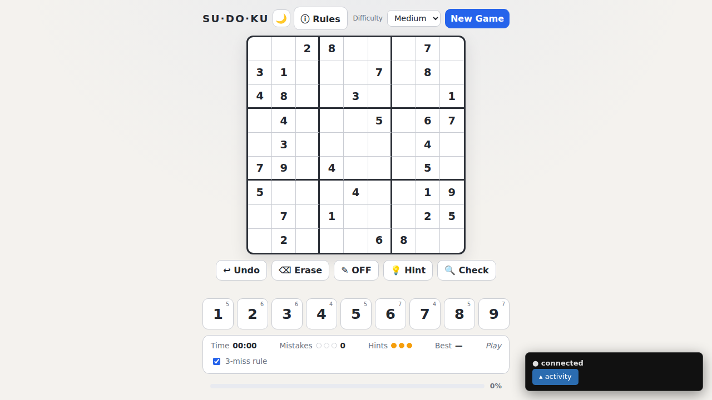
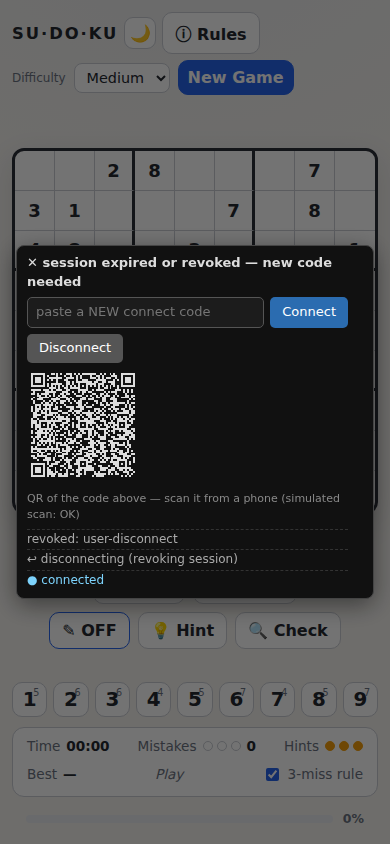

# Sudoku

A complete, dependency-free Sudoku game in plain HTML/CSS/JavaScript.
Open `index.html` directly in a browser, or serve the folder with any static
server (e.g. `npx serve sudoku` / `python3 -m http.server` from `sudoku/`).

## Play

> **First time?** Press the **ⓘ Rules** button in the top bar (or see below)
> for the in-game How to Play panel.

**The rules:** the classic game — every row, every column and every 3×3 box
must end up containing the digits 1–9, each exactly once. Pre-filled bold
digits are fixed. Wrong placements are marked red; with the 3-miss rule on,
three mistakes ends the game.

- **ⓘ Rules** — in-game How to Play panel (goal, input, notes, penalties, tips).
- **Click** a cell to select it (highlighted row / column / box, matching
  digits, pencil notes).
- **Type 1–9** or use the digit pad to fill a cell.
- **Notes mode** (`N`): typing toggles pencil marks; placing a real digit
  automatically clears that digit's notes from all neighboring cells.
- **Undo** (`U`) — placements, erases, notes and hints are all undoable
  (including undoing a fatal third mistake).
- **Erase** (`0` / `Backspace` / `Delete`).
- **Hint** (`H`) — 3 per game; reveals the correct digit (fixes a wrong
  cell first).
- **Check** (`C`) — flashes every currently-wrong cell.
- **Theme toggle** (🌙) — cycles system / light / dark; the choice is
  remembered across sessions.
- **Progress bar** — a thin bar in the footer tracks how far you're through
  the puzzle (matched cells ÷ total non-given cells), with a green→blue
  gradient as it fills.
- **Confetti** — a celebratory burst falls when you complete a puzzle.
- **3-miss rule** — by default, 3 wrong placements ends the game; the
  footer toggle (persisted in `localStorage`) switches it off for
  open-ended play.
- **Movement** — arrow keys or WASD.

Givens (bold) are locked. Wrong entries turn red instantly. Best times per
difficulty are saved in `localStorage` and shown in the footer.

### Keyboard reference

| Key | Action |
| --- | --- |
| `1`–`9` | Place / toggle note |
| `←→↑↓` / `WASD` | Move selection |
| `0`, `Backspace`, `Delete` | Erase |
| `N` / `P` | Toggle notes mode |
| `H` | Hint |
| `U` | Undo |
| `C` | Check mistakes |

## Difficulties

| Level | Target clues | Notes |
| --- | --- | --- |
| Easy | 36 | Rotationally symmetric |
| Medium | 32 | Rotationally symmetric |
| Hard | 27 | Mostly symmetric |
| Expert | 24 | Single-cell fine-tune pass may break symmetry |

Every puzzle is generated with a **guaranteed unique solution** (backtracking
solution counter with MRV ordering, capped at 2). Puzzles are derived from a
32-bit seed shown in the end-of-game modal ("Puzzle code") — the same seed
always produces the same puzzle.

## Architecture

```
sudoku/
├── index.html          # markup: board, pad, controls, HUD, modal
├── css/style.css       # light/dark theme, board + control styling
├── glassbox.js         # Glassbox browser SDK (v1 bundle)
├── src/
│   ├── rng.js          # mulberry32 seeded PRNG + Fisher-Yates shuffle
│   ├── generator.js    # unique-solution puzzle generation & grid math
│   ├── game.js         # game state & rules (pure, DOM-free)
│   ├── ui.js           # DOM rendering, input, HUD, modal, persistence
│   ├── main.js         # entry point (boots on DOMContentLoaded)
│   └── glassbox-setup.js # MCP bridge: registers tools + renders widget
└── tmp/                # git-ignored local dev/tooling artifacts
    ├── validate.cjs    # 73-check logic test suite (generator + rules)
    ├── validate-report.txt
    ├── dom-smoke.cjs   # headless smoke test with a minimal fake DOM
    ├── screenshot.cjs  # real-Chromium screenshots (light/dark/mid-game/won)
    ├── sample-puzzles.json
    └── shot-*.png      # captured reference screenshots
```

`glassbox.js` is a generated copy of the repo's `dist/glassbox.js`. After an
SDK change: `npm run build && cp dist/glassbox.js sudoku/glassbox.js`.

All `src/` files are UMD-style IIFEs: they attach to `window.*` in the
browser and expose `module.exports` under Node, which is what the test
harnesses rely on. No build step, no dependencies.

### Key design points

- **`game.js` is pure logic** — it knows nothing about the DOM, which keeps
  the rules unit-testable headlessly.
- **Generation**: full random grid via backtracking (MRV cell selection),
  then digits removed in 180°-rotation symmetric pairs while a solution
  counter (capped at 2) confirms uniqueness; a single-cell pass fine-tunes
  the clue count when pair removal stalls.
- **Rendering** is fully state-driven: every user action mutates game state,
  then the UI re-renders board class flags, pad remaining counts, mistake
  pips, hint dots, and the timer (250 ms ticker).
- **Undo** stores full per-cell snapshots (`num` + note mask + whether the
  step was a mistake/hint), so counters are restored correctly and a loss
  can be undone.

## Tests

```bash
node tmp/validate.cjs    # generator + game rules (73 checks)
node tmp/dom-smoke.cjs   # full UI session against a minimal fake DOM
node tmp/screenshot.cjs  # chromium screenshots → tmp/shot-*.png
                          # (needs `playwright`, browsers in the shared cache)
```

Both exit non-zero on failure and leave reports/samples in `tmp/`.

## Glassbox (MCP bridge)

The game can be played by an MCP client through the Glassbox bridge. Serve
the folder over HTTP on `127.0.0.1` (**not** `localhost` — origin matching is
exact), then in the widget paste a connect code minted with that same origin:

```bash
python3 -m http.server 3002 --bind 127.0.0.1 --directory sudoku
# MCP client: glassbox_code { app: "sudoku-game", origin: "http://127.0.0.1:3002" }
```

**For recording/demo:** `bash sudoku/demo.sh` from the repo root starts the
page and a supervised bridge, reads the ephemeral port, and prints a fresh
one-shot code (plus its ASCII QR) ready to paste. Ctrl-C stops both processes.

`src/glassbox-setup.js` registers nine tools: `get_state` and `check` are
read-tier; `new_game`, `select`, `input_number`, `erase`, `hint`, `undo` and
`toggle_notes` are write-tier, so every call raises a consent dialog in the
widget before it runs. `tmp/glassbox-browser.cjs` is a small Playwright
helper that opens the page, pastes a code and auto-approves those dialogs
for an unattended play-through.

### The widget

`renderWidget(gbox)` (no options) uses the SDK's two-phase placement: until
connected, the widget is a centred overlay with the code input and QR; the
moment the session is live it collapses to a small **● connected · activity**
dock in the bottom-right corner. Click **activity** to expand the call feed.
The page never scrolls — the widget is `position: fixed` in both phases.





### Why this is the demo for the privacy story

The agent observes the board through `get_state`, which returns nine strings —
not a screenshot. Nothing rendered by the page (no other tabs, no unrelated
DOM, no pixel content) is serialized to the model. The game also owns all of
its own state: there are no credentials or secrets for the agent to handle,
and no tool argument carries one. See the root README's "Why not Playwright?"
section for the full reasoning.
